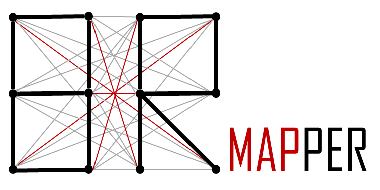

# Welcome to BRMapper

## Generate Atom-to-atom maps of complex enzymatic reactions.

BRMapper predicts atom-to-atom mappings (AAMs) for enzymatic reactions by treating mapping prediction as a selection problem. It combines Maximum Common Edge Subgraph-based enumeration with machine learning to identify chemically feasible mappings, even in complex reactions such as ring closures and ring eliminations. For further information, please check [the preprint](https://papers.ssrn.com/sol3/Delivery.cfm?abstractid=7404606).

