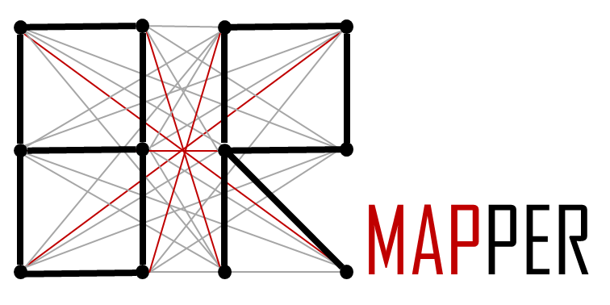

<p align="center">



</p>


# Welcome to BRMapper

## Generate Atom-to-atom maps of complex enzymatic reactions.

BRMapper predicts atom-to-atom mappings (AAMs) for enzymatic reactions by treating mapping prediction as a selection problem. It combines Maximum Common Edge Subgraph-based enumeration with machine learning to identify chemically feasible mappings, even in complex reactions such as ring closures and ring eliminations. For further information, please check [the preprint](https://papers.ssrn.com/sol3/Delivery.cfm?abstractid=7404606).

## Run Experiments

Commands to verify the full BRMapper pipeline (stages 01-03) using the bundled ringreactions example data. 

Every stage runs in Docker, so apart from Docker itself no dependencies need to be installed on the host. A single image covers all three stages. 

### 1. Build the container image

```bash
docker build -t biermapper:latest .
```

### 2. MCES/ITS Enumeration

```bash
mkdir -p results/its
docker run --rm --user $UID:$GID -v .:/workspace -w /workspace/code/01_mces_its \
    biermapper:latest python run_testset.py ../../data/aam_ringreactions.csv 10 ../../results/its
```

### 3. Prepare AAM Candidates for Preprocessing

```bash
docker run --rm --user $UID:$GID -v .:/workspace -w /workspace/results/its \
    biermapper:latest bash -c 'zip ../candidates.zip rxn_*.pickle'
```

### 4. Preprocessing

```bash
printf '%s\n' \
    'input_data/ringreactions_gt.csv' \
    '../../results/candidates.zip' \
    'results' | \
docker run --rm -i --user $UID:$GID -v .:/workspace -w /workspace/code/02_data_preprocessing \
    biermapper:latest bash data_preprocessing.sh
```

### 5. SVM Training

```bash
docker run --rm --user $UID:$GID -v .:/workspace -w /workspace/code/03_model_training biermapper:latest \
    python train_test_svm.py +ds_train=tudata +ds_test=tudata +model=NSPD runs=1 subset=1000
```

### 6. GNN Training

Add ``--gpus all`` if you want to use your GPU for GNN training.

```bash
docker run --rm --user $UID:$GID -v .:/workspace -w /workspace/code/03_model_training biermapper:latest \
    python train_test_gnn.py +ds_train=tudata +ds_test=tudata +model=GIN runs=1 model.epochs=5
```
